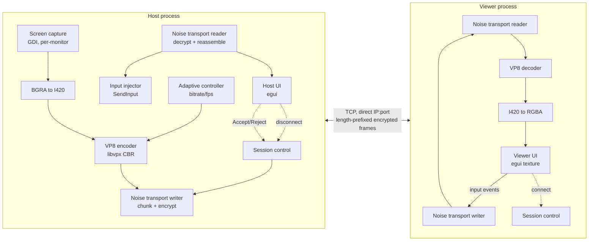

# DeskBeam Architecture

## 1. Goals and non-goals

### Goals

1. One portable executable per platform; no installation, no service, no
   administrator requirement for normal operation.
2. Direct connection by `IP:port`; no rendezvous, relay, or cloud account.
3. One-time access code, host Accept gate, end-to-end encryption, visible
   session state, one-click disconnect.
4. Interactive screen streaming with adaptive bitrate, remote input, and a
   code path for clipboard, files, monitors, and chat.

### Non-goals (by design)

- Unattended access, saved passwords, or persistent host keys.
- NAT traversal, hole punching, or relay infrastructure. DeskBeam assumes the
  machines can already reach each other (same LAN, or a VPN such as WireGuard
  or Tailscale).
- Privilege escalation. The host process runs at the user's normal integrity
  level (`asInvoker`), so it cannot drive elevated windows.
- Concealment. The host always shows an active-session indicator, changes the
  window title to `DeskBeam - SESSION ACTIVE`, and keeps a disconnect control
  available.

## 2. Component diagram



### Text form (same information)

```
HOST                                              VIEWER
┌──────────────────────────────┐   TCP (E2E)   ┌─────────────────────────────┐
│ capture (GDI)                │◄─────────────►│ decrypt / reassemble        │
│   → BGRA→I420                │               │   → VP8 decode              │
│   → VP8 encode (libvpx)      │  video frames │   → I420→RGBA               │
│   → chunk + Noise encrypt    │──────────────►│   → egui texture            │
│                              │               │                             │
│ decrypt / reassemble         │  input events │ pointer/keyboard capture    │
│   → SendInput                │◄──────────────│   → serialize               │
│                              │               │                             │
│ host UI: code, Accept modal, │               │ viewer UI: address, code,   │
│ active banner, stats, stop   │               │ stream, stats, disconnect   │
└──────────────────────────────┘               └─────────────────────────────┘
```

## 3. Module boundaries

| Module | Responsibility | Must not know about |
|---|---|---|
| `proto` | Wire framing, chunk reassembly, message types, serialization | UI, codecs, OS APIs |
| `crypto` | SPAKE2, HKDF, Noise handshake and transport | screen, input, UI |
| `capture` | Monitor enumeration and BGRA frame capture | crypto, UI |
| `codec` | BGRA↔I420, VP8 encode/decode | sockets, UI |
| `input` | InputEvent → OS injection | capture, crypto |
| `session::host` | Listener, accept gate, threads, adaptive control | egui widgets |
| `session::viewer` | Connect, handshake, decode loop | egui widgets |
| `app` | egui screens, commands, status rendering | wire details |

Platform-specific code lives behind `#[cfg(windows)]` in `capture`, `input`, and
`main` (DPI awareness). The Linux milestone implements the same traits over
PipeWire/Portal and `uinput`/XTest, leaving protocol and UI untouched.

### 3.1 Repository layout

```
E:\Vibe\anydesk\
├── Cargo.toml                 single portable crate; features, release profile
├── Cargo.lock                 pinned dependency graph (commit this)
├── build.ps1                  release build + copy to .\DeskBeam.exe
├── .gitignore
├── README.md
├── THIRD_PARTY.md             license inventory
├── docs\
│   ├── ARCHITECTURE.md        this document
│   ├── PROTOCOL.md            normative wire format
│   ├── MILESTONES.md          scope M0–M6
│   ├── BUILD.md               toolchain and packaging
│   ├── TEST_PLAN.md           functional, security, NAT/firewall
│   └── RE_NOTES.md            AnyDesk loader analysis (no code reuse)
├── src\
│   ├── main.rs                CLI, DPI setup, eframe entry
│   ├── app.rs                 egui screens, accept modal, input capture
│   ├── session.rs             host listener/accept gate + viewer net loop
│   ├── crypto.rs              SPAKE2, HKDF, Noise, chunked encryption
│   ├── proto.rs               framing, chunking, message schema
│   ├── codec.rs               BGRA↔I420, VP8 encode/decode
│   ├── capture.rs             monitor enumeration, GDI capture
│   ├── input.rs               SendInput injection and coordinate mapping
│   ├── selftest.rs            loopback end-to-end test
│   └── util.rs                one-time code, addresses, time
├── re_analysis\               analysis outputs for the reference sample
│   ├── tools\pe_info.py
│   └── strings_*.txt
└── AnyDesk.exe                third-party reference sample (not built/linked)
```

The protocol, crypto, codec, and UI modules have no Windows-specific code. Only
`capture.rs` and `input.rs` contain `#[cfg(windows)]` blocks, so the Linux
backend is additive rather than a rewrite.

## 4. Threading model

Host:

```
UI thread ── commands ──► Listener thread ── accepted socket ──► Handshake
   ▲                                                              │
   │ events                                                Accept/Reject
   │                                                              ▼
   ├──────────── Session reader thread ◄── decrypt ──────── Session
   ├──────────── Capture+encode thread ── video ──► Writer thread ──► TCP
   └──────────── stats channel
```

Viewer:

```
UI thread ── connect ──► Net thread: connect + handshake + Noise
   ▲                         │
   │ RGBA frames             ├─► Reader loop: decrypt → VP8 decode → channel
   └─────────────────────────┤
        input events ────────┴─► Writer queue (bounded for video, control priority)
```

Rules:

- Exactly one writer owns the TCP write half; exactly one reader owns the read
  half. The Noise `TransportState` is shared behind a mutex because send and
  receive cipher states are independent and encryption is cheap.
- Video uses a **bounded** queue. If the network is slow, the newest frame
  replaces the oldest; control messages never block behind video.
- The UI never performs blocking I/O. It drains events and renders the latest
  decoded frame; intermediate frames may be dropped.
- Every thread has an `AtomicBool` stop flag and exits on disconnect or window
  close.

## 5. Data flow: one video frame

1. **Capture** — `BitBlt` from the display DC into a reusable 32-bit DIB.
   Primary monitor first; per-monitor rectangles are enumerated at startup.
2. **Convert** — BGRA → I420 (BT.601 limited range) into reusable planes.
   Dimensions are rounded down to even numbers for VP8 4:2:0.
3. **Encode** — libvpx VP8, realtime deadline, CBR, keyframe every 60 frames,
   error-resilient mode. Output copied into a `VideoFrame` message.
4. **Frame** — message serialized (bincode), split into chunks whose plaintext
   is at most 60 000 bytes, each chunk encrypted with Noise ChaCha20-Poly1305.
5. **Send** — each ciphertext is written as `u32 length || ciphertext`.
6. **Receive** — viewer reads a length, decrypts, reassembles by message ID.
7. **Decode** — VP8 decoder produces I420; convert to RGBA.
8. **Display** — egui uploads the RGBA buffer to a texture, letterboxed to the
   available rect.

## 6. Adaptive quality

The controller runs once per second on the host:

| Signal | Action |
|---|---|
| Writer queue > 2 frames, or encode > 30 ms | bitrate × 0.75 (floor 600 kbps) |
| Viewer reports < 8 fps or RTT > 250 ms | bitrate × 0.75 |
| Queue empty, encode < 12 ms, RTT < 80 ms | bitrate × 1.10 (ceiling 12 Mbps) |
| Any resolution change | force keyframe, reset controller |

Range: 600 kbps – 12 Mbps, CBR. Resolution is not changed automatically in the
MVP; a later milestone adds downscale/upscale and region-of-interest hints.
Frame rate is naturally bounded by capture+encode time; the loop targets 30 fps.

## 7. Security design

### 7.1 Threat model

| Adversary | Capability | Mitigation |
|---|---|---|
| Passive network attacker | Reads all bytes | Noise encryption; no plaintext metadata inside transport |
| Active MITM | Modifies/relays handshake | SPAKE2 binds the code; Noise PSK binds the transcript; one guess per connection |
| Offline guesser | Records a session, guesses later | PAKE reveals no verifier; no offline dictionary |
| Online guesser | Repeated connections | One attempt per connection, code rotates on failure, handshake timeout, per-IP backoff (M6) |
| Malicious viewer with the code | Knows the code | Host Accept gate; visible banner; disconnect |
| Malicious host | Controls the host | Encryption hides traffic from the network, not from the host itself (inherent to remote desktop) |
| Local user on host | Watches the screen | Session indicator and peer address always visible |

### 7.2 Handshake

```
viewer                                             host
  │ ── ClientHello (magic, version) ──────────────► │
  │ ◄──────────────── ServerHello (magic, version) ─│
  │ ── SPAKE2 msg A (33 bytes) ───────────────────► │
  │ ◄──────────────── SPAKE2 msg B (33 bytes) ──────│
  │      both derive K = SPAKE2 secret              │
  │      PSK = HKDF-SHA256(K, "deskbeam/v1/noise-psk")
  │ ── Noise msg 1 ───────────────────────────────► │
  │ ◄──────────────── Noise msg 2 ──────────────────│
  │ ══════ encrypted transport ═════════════════════│
  │ ── Hello{name, capabilities} ──────────────────► │
  │ ◄──────────────── AcceptRequest ────────────────│  (host UI prompts)
  │         host clicks Accept / Reject             │
  │ ◄──────────────── Accept + SessionInfo ─────────│
  │ ◄──────────────── VideoFrame... ────────────────│
  │ ── InputEvent... ─────────────────────────────► │
```

- Wrong code → SPAKE2 `finish` fails or Noise decryption fails → connection
  closed, code rotated, event surfaced in the host UI.
- Replay of a recorded handshake fails: fresh ephemeral scalars and nonces.
- The code is normalized to 9 digits and never logged.

### 7.3 Code lifecycle

- Generated with the OS CSPRNG (`rand::rngs::OsRng`) when the listener starts.
- Displayed as `XXX-XXX-XXX`; compared after stripping separators.
- Rotated after: successful session end, rejection, authentication failure,
  listener restart, and 10 minutes of inactivity (M6; MVP rotates on
  disconnect/failure/restart).
- Never written to disk and never included in logs.

### 7.4 Message limits

- TLS-style record cap: 64 KiB ciphertext; plaintext chunks ≤ 60 000 bytes.
- Logical message cap: 16 MiB.
- Chunk reassembly cap: 4096 chunks and 16 MiB per message; a violation closes
  the session.
- Handshake timeout 10 s; authentication attempt limit 1 per connection.
- Idle timeout 60 s without any frame/ping (M6).

### 7.5 Input-injection caveats (Windows)

- `SendInput` is subject to UIPI. A normal-integrity host cannot send input to
  elevated windows. This is a Windows security boundary, not a bug.
- `Ctrl+Alt+Del` is a Secure Attention Sequence and cannot be synthesized.
- The viewer can only produce input while the host session is active and the
  host has not disconnected.

## 8. Transport and framing

- TCP with `TCP_NODELAY`, because latency matters more than packing.
- One connection carries one session. No multiplexing across sessions.
- Length-prefixed encrypted chunks (see [PROTOCOL.md](PROTOCOL.md)).
- Version negotiation is explicit; mismatched major versions abort before any
  cryptography.

Why TCP over UDP in the MVP: direct LAN/VPN links are usually clean, and TCP
removes an entire class of reordering/loss bugs. The protocol keeps message
boundaries and sequence numbers so a future QUIC/datagram transport can reuse
the same message layer. Latency-sensitive deployments should prefer a VPN with
a good path; head-of-line blocking is the known trade-off.

## 9. Technology choices

| Choice | Rationale |
|---|---|
| **Rust + egui** | One static executable, no runtime install, memory safety for network-facing code, first-class Windows/Linux support, permissive dependencies |
| **libvpx VP8** | BSD, royalty-free, proven for screen sharing; adaptive CBR and keyframes built in; a prebuilt static library avoids a native toolchain |
| **SPAKE2 (Ed25519)** | One round trip, no PKI, no offline dictionary attack, RFC 9382 family; RustCrypto implementation |
| **Noise `NNpsk0`** | Minimal, well-reviewed pattern; PSK binds the PAKE result; X25519 ephemeral keys give forward secrecy; `snow` is pure Rust |
| **bincode 1.3** | Compact, deterministic, serde-based; schema documented so other implementations can interop |
| **GDI capture** | No extra dependency, works on all Windows versions and sessions; DXGI Desktop Duplication is a later performance upgrade |
| **SendInput** | The only user-mode, non-driver input path; respects Windows security boundaries |

### Rejected alternatives

- **H.264/OpenH264**: BSD-style library but patent licensing applies to
  distributed binaries; hardware encode would be faster but adds licensing and
  platform complexity.
- **AV1/rav1e**: royalty-free and pure Rust, but software realtime encoding at
  1080p is too CPU-heavy for a portable tool.
- **TLS 1.3/rustls with PSK**: auditable, but P2P PSK plumbing and certificate
  identity are heavier than Noise for this use case; Noise has no PKI at all.
- **SRP-6a**: older, fewer maintained implementations, and no forward secrecy
  without extra work.
- **Electron/WebRTC**: violates the single-small-executable and no-runtime goals.

## 10. Failure modes and recovery

| Failure | Detection | Behavior |
|---|---|---|
| Wrong code | SPAKE2/Noise failure | Close, rotate code, show host warning |
| Host rejects | UI action | Send Reject, close, rotate code |
| Network drop | read/write error or timeout | Tear down threads, return to listening |
| Viewer too slow | queue depth, reported fps | Lower bitrate; drop frames; never block UI |
| Encoder error | libvpx error | Force keyframe; if repeated, end session with error |
| Resolution change | monitor selection / display change | Recreate capture and encoder, force keyframe |
| Port in use | bind error | Show actionable error, keep UI usable |
| Unreachable host | connect timeout | Clear viewer error, no retry storm |

## 11. Performance envelope (MVP targets)

| Metric | Target |
|---|---|
| 1080p capture + convert + VP8 encode | ≤ 25 ms/frame on a modern 4-core CPU |
| Glass-to-glass latency on LAN | ≤ 80 ms at 20–30 fps |
| Idle bandwidth (static screen) | ≤ 300 kbps |
| Active bandwidth (scrolling/video) | 2–8 Mbps, adaptive |
| CPU at 1080p30 | ≤ 35% of one modern core (encode), plus capture |
| Executable size | 8–20 MB, no external runtime |

These are engineering targets, not benchmark results; the test plan records
measured values per release.
